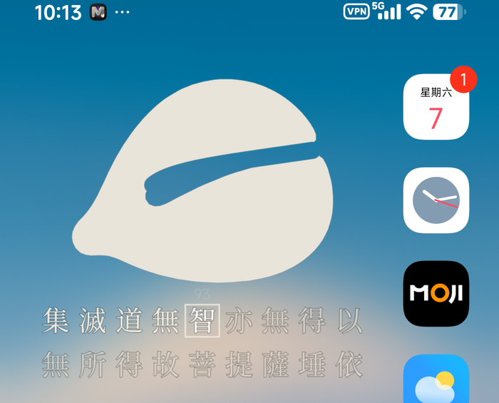
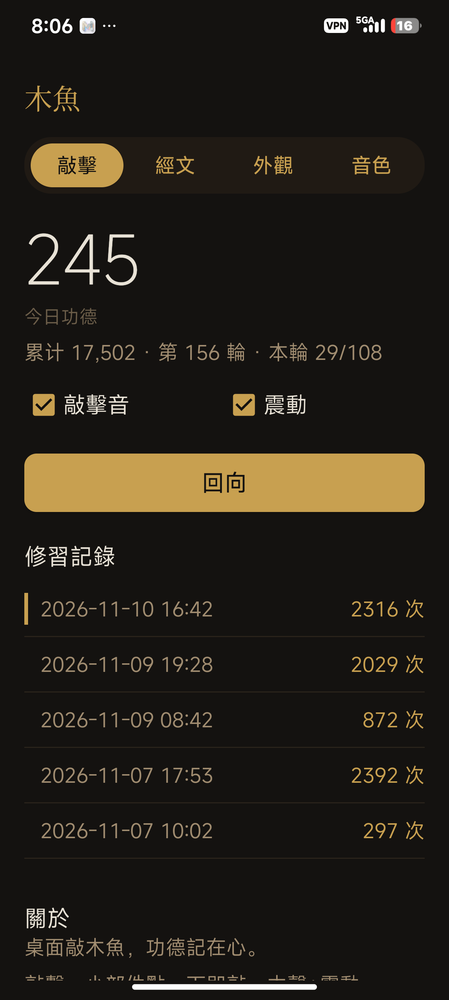
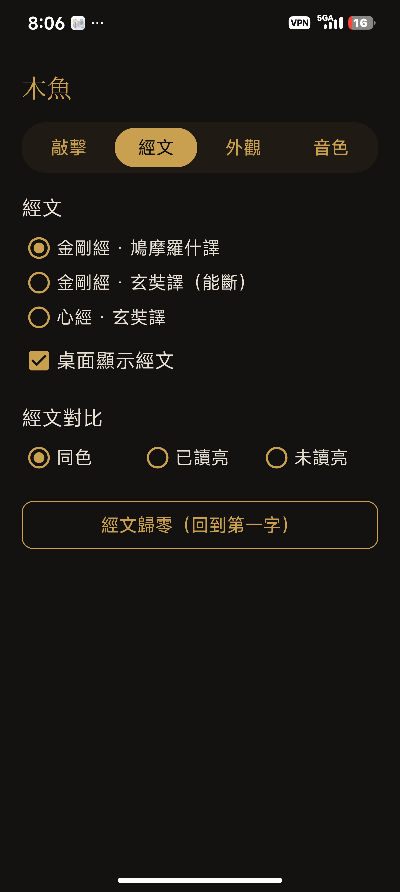
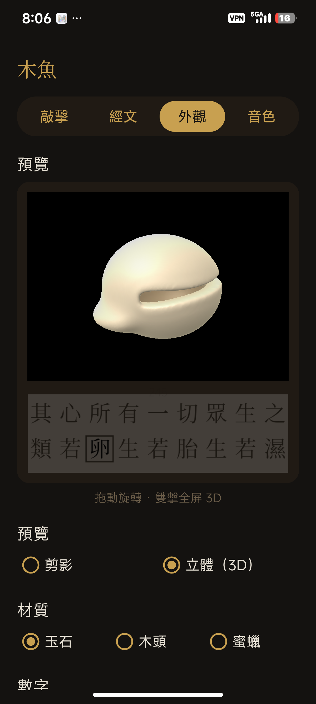
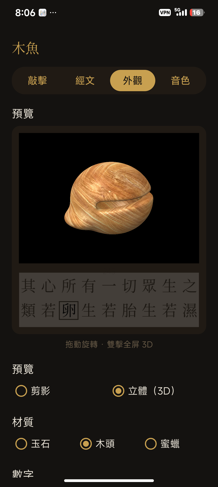
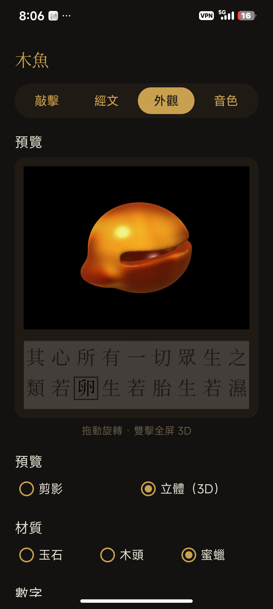
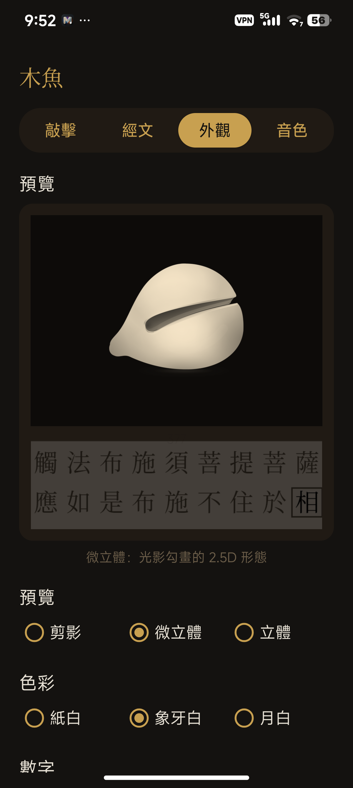
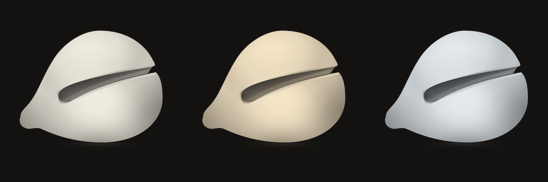

# 木魚 · Muyu Widget

> 一个只在桌面上敲的木鱼。点一下，木声一响，数字加一，经卷前行一字。
> **A minimal wooden-fish (木鱼) home-screen widget — built entirely on a phone, without a computer.**

<p align="center">
  <a href="../../releases/latest"></a>
  <a href="LICENSE"></a>
</p>

<p align="center">
  
  
  
</p>

<p align="center">
  
  
  
</p>

<p align="center"><sub>渲染的三种材质：和田玉 · 木头 · 蜜蜡（App 内可拖动的实时 3D，双击全屏）</sub></p>

<p align="center">
  
  
</p>

<p align="center"><sub>微立体（2.5D）：光影勾画的静态形态；剪影与 2.5D 都支持 紙白 / 象牙白 / 月白 三种白</sub></p>

---

## ✦ 下载

安装包不放在仓库里（保持仓库轻量），请到 **[Releases](../../releases/latest)** 下载最新的 `muyu-vX.Y.Z.apk`，直接安装即可。

> 首次安装若提示"未知来源"，允许一次即可；MIUI/HyperOS 还需为应用打开**自启动**（原因见下方"平台坑"）。

---

## ✦ 这个项目是「纯手机开发」

**没有电脑、没有 Android Studio、没有 Gradle、没有外接键盘。**

从第一行代码到最后签名的 APK，全部在一台 Xiaomi 手机（HyperOS / Android 16 / aarch64）上完成：写代码、画矢量素材、合成音效、编译打包、签名、安装、截图验证——工具链全部跑在手机本地。

### 开发环境全景

| 层 | 工具 | 在项目里干什么 |
|---|---|---|
| **终端** | [Termux](https://f-droid.org/packages/com.termux/)（F-Droid 版） | 手机上的 Linux 环境，所有构建都在这里执行 |
| **JDK** | `openjdk-17` / `openjdk-21`（Termux pkg） | 提供 `javac`、`keytool`、`apksigner` 运行时 |
| **打包** | `aapt`（Termux pkg，原生 aarch64） | 编译 `res/` 资源、生成 `R.java`、封 APK |
| **转 dex** | `dx`（Termux pkg） | `javac` 产物 → `classes.dex` |
| **签名** | `apksigner`（Termux pkg） | v1+v2+v3 签名（自签密钥 `woodfish.jks`） |
| **SDK** | `platform-36_r01.zip` → `android-36/android.jar` | 编译期 API 依赖（aarch64 上直接 `curl` 下载，不装 SDK Manager） |
| **构建入口** | `build.sh` | 一条命令跑完 `aapt → javac → dx → zip → apksigner` |
| **特权通道** | [Shizuku](https://shizuku.rikka.app/) | 通过 adb 级权限执行 `pm install`、`dumpsys`、`screencap`、`logcat` |
| **AI 编码** | Minis（运行在同一台手机上） | 读写源码、调用 Termux 构建、抓日志、截图比对、迭代 UI |
| **图形素材** | Python 3 + Pillow + NumPy | 参数化生成木鱼剪影（钢笔路径法）、敲击帧、图标、预览图 |
| **音效** | NumPy + `wave` | 纯代码合成木鱼音（3 音色）与磬声，无任何采样版权问题 |
| **3D 原型（已废弃）** | WebGL2 + raymarching（SDF） | 早期做过一版可旋转的 3D 木鱼，手机上用浏览器实时预览 |

### 「没有电脑」是怎么做到的

```
手机屏幕 ── 写代码（编辑器 / AI）
      │
      ├─ Termux：javac + aapt + dx + apksigner → APK
      │
      ├─ Shizuku：pm install → 装到桌面
      │
      └─ logcat / dumpsys appwidget / screencap → 回看效果，继续改
```

几个让这件事成立的关键点：

1. **不依赖 Gradle**：`aapt` 手动打包资源 + `javac` 直接编译 + `dx` 转 dex，总构建时间约 20 秒。
2. **不依赖 SDK Manager**：`android.jar` 直接 `curl` 下载官方 zip 解压。
3. **不依赖 adb/电脑**：安装与调试走 Shizuku（`pm install`、`dumpsys`、`screencap`、`logcat` 全部可用）。
4. **素材也不需要电脑**：木鱼剪影用「钢笔路径法」Python 脚本参数化生成，可导出 SVG 给设计师继续改；音效用 NumPy 合成。
5. **验证闭环**：每次改动 → 构建 → 安装 → `screencap` 截图 → 像素级比对（例如用亮度投影计算经文行是否有 1px 位移）。

> 换句话说：**这台手机既是设计工具、编译机，也是测试机。**

---

## ✦ 功能

- **桌面即产品**：整张卡片就是木鱼，点一下即敲；不需要打开 App。
- **今日功德**：跨零点自动归零；累计功德与轮次永久保留。
- **108 一轮**：每敲满 108 次响一声磬、轮次 +1（跨天连续累计，每个 108 倍数都会响）。
- **三本经文**：金刚经（罗什，5174 字，对齐佛恩网底本）/ 能断金刚分（玄奘，8222 字）/ 心经（260 字），读音逐处校准。
- **经卷行**：两行 × 9 字，方框逐字前进；可选《金刚经》（5,214 字）或《心经》（260 字），读满循环。
- **回向**：清空今日数字并记入「修習記錄」，不动经文位置。
- **实时 3D 预览**：外觀页的小窗是真实 OpenGL ES 2.0 渲染的 3D 木鱼——拖动旋转、双指缩放、双击全屏；停手 0.7 秒自动把当前角度烘焙成桌面小部件的基底图，**预览定什么角度，桌面就是什么角度**。
- **三种材质**：和田玉（暖白、真透明、边缘透光）/ 木头（清漆、深纹清晰）/ 蜜蜡（深橙、亮黄分区、锐高光）。切换材质后自动重烘基底图，桌面即刻同步。
- **三种形态**：剪影（纯平面）/ 微立體（2.5D 光影稿）/ 立體（3D）。
- **三种白**：剪影与 2.5D 共用 紙白 / 象牙白 / 月白，运行时染色，切换即时生效。
- **纸质经卷**：经文行可铺一条深色宣纸纸纹（底板强度 0–60% 由「底襯」滑杆控制，0 = 完全无底）。
- **诵读**：开启后每敲一下读出当前的字；读音依《金刚经诵读笔记》校正（般若 bō rě、祇树 qí、降伏 xiáng、愿乐 yào…）。
- **全部可调**：数字位置（不显示 / 木鱼下 / 经文右下）、敲击时数字是否加亮、经文对比模式（同色 / 已读亮 / 未读亮）、音效与震动开关、字号与记录账簿式排版（等宽数字）。

---

## ✦ 目录结构

```
.
├── app/src/main/
│   ├── AndroidManifest.xml
│   ├── assets/
│   │   ├── sutra.txt          # 金刚经（繁体、无标点，5,214 字）
│   │   └── xinjing.txt        # 心经（260 字）
│   ├── assets/models/
│   │   └── woodfish_jade_mobile.glb   # 3D 模型（59k 面，含顶点色）
│   ├── design/jade_v9.svg     # 2.5D 微立体的矢量源稿
│   └── res/
│       ├── layout/            # widget.xml（小部件） / activity_main.xml（设置页） / activity_model3d.xml
│       └── drawable-nodpi/    # 剪影、敲击帧、纸纹 paper.png、木纹 wood.png、蜜蜡 amber.png
├── java/com/minis/muyu/
│   ├── FishWidget.java        # 小部件：敲击、位图渲染、音效、振动
│   ├── JadeView.java          # 实时 3D 视图（拖动/缩放/双击，小窗与全屏共用）
│   ├── Off3D.java             # 离屏 3D 渲染：把当前视角烘焙成小部件基底图（EGL pbuffer）
│   ├── GlbMesh.java           # GLB 解析（POSITION/COLOR_0/索引，运行时算法线）
│   ├── JadeRender.java        # 2D 合成与阴影（基座图 → 小部件位图）
│   ├── FlatRender.java        # 剪影/2.5D 染色（ColorMatrix，三种白）
│   ├── Model3DActivity.java   # 全屏 3D 预览页
│   ├── MuyuState.java         # 状态与设置（SharedPreferences）
│   ├── SutraText.java         # 经文加载
│   └── MainActivity.java      # 设置页 / 修習記錄 / 關於
├── build.sh                   # 一键构建（Termux）
├── muyu_shape.py              # 剪影生成（钢笔路径 + SVG 导出）
├── gen_sounds.py              # 音效合成（木鱼 ×3 + 磬）
└── gen_icon.py                # 图标生成（含 Android 13 主题图标）
```

---

## ✦ 构建

### 1. 准备 Termux

```bash
pkg install -y openjdk-17 aapt dx apksigner zip unzip curl
mkdir -p ~/woodfish && cd ~/woodfish
# android.jar（约 66MB）
curl -LO https://dl.google.com/android/repository/platform-36_r01.zip
unzip platform-36_r01.zip && mv android-36/android.jar ./sdk-android.jar
```

### 2. 构建

把本仓库放到 Termux 可访问的位置（如 `~/woodfish`），然后：

```bash
bash build.sh        # 产物：build/woodfish.apk
```

`build.sh` 的完整流程：

```bash
aapt package -f -M AndroidManifest.xml -S res -A assets -I android.jar -J gen -F base.apk
javac --release 8 -cp android.jar -d classes @sources.txt
dx --dex --output=classes.dex classes
zip base.apk classes.dex
apksigner sign --ks woodfish.jks --out woodfish.apk base.apk
```

> 首次运行会自动用 `keytool` 生成 `woodfish.jks`。**这个密钥务必保留**，否则升级安装会报 `INSTALL_FAILED_UPDATE_INCOMPATIBLE`。

### 3. GitHub Actions 云端构建（可选）

仓库自带 `.github/workflows/build.yml`：推送到 `main` 自动构建，打 `v*` tag 会自动构建并挂到 Release。同样不依赖 Gradle。

若希望云端产物能**覆盖升级**你手机上本地构建的版本，需要在仓库 Secrets 里放同一把签名密钥：

| Secret | 内容 |
|---|---|
| `KEYSTORE_BASE64` | `base64 -w0 woodfish.jks` 的输出 |
| `KEYSTORE_PASS` | keystore 密码 |
| `KEYSTORE_ALIAS` | 密钥别名（默认 `minis`） |

没有配置时，CI 会用一次性密钥签名，产物只能全新安装（不能覆盖升级）。

### 4. 安装

```bash
# 有 Shizuku / adb 均可
pm install -r build/woodfish.apk
```

---

## ✦ 重新生成素材

```bash
python3 muyu_shape.py     # 剪影 + 敲击帧 + SVG（输出到 app/src/main/res/drawable-nodpi/）
python3 gen_sounds.py     # 木鱼 3 音色 + 磬（输出到 res/raw/）
python3 gen_icon.py       # 图标 + 自适应图标 + 主题图标
```

`muyu_shape.py` 顶部集中了全部形状参数（轮廓平滑度、鱼口位置/张口、末端收细、底部压平比例），并同时导出 `muyu.svg`，方便在 Figma / Illustrator 里继续编辑。

---

## ✦ 平台坑（MIUI / HyperOS 实测）

| 现象 | 原因 | 处理 |
|---|---|---|
| 「支持小部件应用」列表里找不到本应用 | HyperOS 只收录应用商店分发的应用 | 从桌面「**安卓小部件**」分区添加，功能完全正常 |
| 桌面点击无反应 | MIUI **Greezer** 冻结后台进程，广播被系统丢弃（`ignored_background`） | 系统设置里允许本应用**自启动** |
| 勾选了震动却感觉不到 | Android 13+ 忽略后台应用的 `USAGE_TOUCH` 振动 | 代码改用 `USAGE_ALARM` + 满振幅 24ms |
| 自定义字体在小部件里不生效 | 启动器在 RemoteViews 里不加载 `res/font` | 数字与经文行改为**运行时绘制 Bitmap**，`setImageViewBitmap` 下发 |
| 敲击后文字跟着轻微位移 | 布局重新测量 + 底部锚点压缩 | 剪影改为**中心锚点收缩**，行位图宽高恒定（实测文字位移 0px） |

---

## ✦ License

MIT

## ✦ 聯繫

- 微博：[@王药师](https://weibo.com/n/%E7%8E%8B%E8%8D%AF%E5%B8%88)
- 推特：[@qq831261](https://twitter.com/qq831261)
